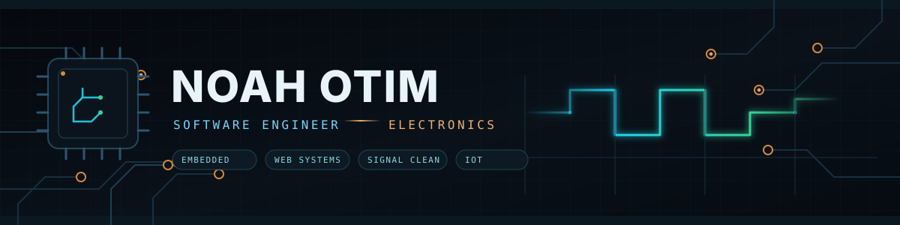
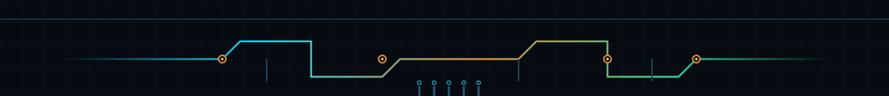

  

  

  
  
  
  

  

### 👋 About Me

I work where **code meets current** — software systems on one side, circuits and sensors on the other. Good engineering in both looks the same: **remove friction, respect the signal, and ship consistently.**

<table>
<tr>
<td valign="top" width="50%">

**🔧 Role**  
Software engineer building practical systems — web, automation and embedded interfaces

**⚡ Electronics**  
Microcontrollers, sensors and serial protocols — turning physical signals into usable data

</td>
<td valign="top" width="50%">

**🎯 Focus**  
Founders and small teams that need tools they can actually run today

**✨ Principle**  
When you see my name: practical, honest, and already working on the next revision

</td>
</tr>
</table>

---

### 🛠️ Software Stack

  

  
  
  
  
  
  

---

### ⚡ Hardware & Electronics

<table>
<tr>
<td valign="top" width="33%">

**Boards**  
ESP32 · Arduino · Raspberry Pi · STM32 basics

</td>
<td valign="top" width="33%">

**Signals**  
GPIO · I²C · SPI · UART · PWM · ADC

</td>
<td valign="top" width="33%">

**Bench**  
KiCad · schematic capture · soldering · multimeter · logic analyzer

</td>
</tr>
</table>

  

  
  
  
  

  <em>From schematic → firmware → dashboard: a sensor reading is only useful once it reaches a screen and a decision.</em>

---

### 📡 Final-Year IoT Project

  

An ESP32 sensor node reads a UPS battery's voltage, temperature and humidity and sends it over LoRaWAN to The Things Network, then Firebase and a Flutter app — so a failing battery at a remote site reports itself before it takes the load down. Field-tested at **1.5 km** reliable range (3.3 km best case), **≤0.1 V** voltage error and **2–3 s** from reading to dashboard, with alerts firing on threshold breaches.

  <a href="https://noahotim.github.io/portfolio/#iot"><b>Read the case study →</b></a>

---

### 🚀 Featured Projects

| Project | Description | Stack |
|---|---|---|
| [**LoRa UPS battery monitor**](https://noahotim.github.io/portfolio/#iot) | Final-year IoT research — LoRaWAN battery monitoring for UPS reliability | ESP32 • LoRa • TTN |
| [**content-growth-machine**](https://github.com/noahotim/content-growth-machine) | Content system for LinkedIn growth — posts, graphics and voice | Next.js • Voice System |
| [**educontrol-school-system**](https://github.com/noahotim/educontrol-school-system) | School management platform | TypeScript • System Design |
| [**otzu-tech-solutions**](https://github.com/noahotim/otzu-tech-solutions) | Agency site and client systems | Next.js • Tailwind |
| [**openremote**](https://github.com/noahotim/openremote) | Open source IoT platform contributions | Java • IoT |

---

### 📈 GitHub Analytics

  
  
  

  
  

  
  

  

---

### 🌍 Contribution Globe

  

  <em>Every commit I author, mapped. Daily-updating globe; click the badge for the interactive <a href="https://github.com/shuding/cobe">Cobe</a> globe. Built from <a href="https://github.com/noahotim/github-contrib-globe-badge">noahotim/github-contrib-globe-badge</a>.</em>

---

### 📊 Activity

  

### 🐍 Contribution Snake

  <picture>
    <source media="(prefers-color-scheme: dark)" srcset="https://raw.githubusercontent.com/noahotim/noahotim/output/github-contribution-grid-snake-dark.svg" />
    <source media="(prefers-color-scheme: light)" srcset="https://raw.githubusercontent.com/noahotim/noahotim/output/github-contribution-grid-snake.svg" />
    
  </picture>

---

### 💡 What I Share

- **Software that earns its place** — automation, tools and interfaces that save hours
- **Hardware notes** — sensor readouts, board bring-up and the boring parts that matter
- **Signal over noise** — growth and content tactics that compound

### 📬 Connect

  <b>Open to collaborations on embedded products, IoT systems and practical software.</b> 
  <a href="https://github.com/noahotim">GitHub</a> • <a href="https://noahotim.github.io/portfolio/">Portfolio</a> • Content Growth Machine • EduControl

  

  <i>Designed as a circuit — built with <a href="https://github.com/LHRUN/bubble">Bubble</a></i>

  

